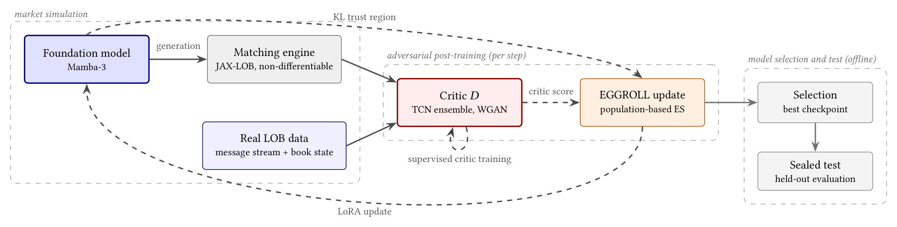

---

*This paper grew out of my [Master's thesis](/research_projects/msc-thesis/) in the [British Open-ended Learning and Discovery Lab (BOLD)](https://bold-lab.ai/) at the University of Oxford, supervised by [Professor Ani Calinescu](https://www.cs.ox.ac.uk/people/ani.calinescu/) and [Professor Jakob Foerster](https://www.jakobfoerster.com/). It will appear at the 7th ACM International Conference on AI in Finance (ICAIF ’26) in Milan, in November 2026.*

  <a class="button" style="flex:1;text-align:center;margin:0;padding:5px 10px;background:rgba(0,0,0,0.1);" href="paper.pdf">Paper</a>
  <a class="button" style="flex:1;text-align:center;margin:0;padding:5px 10px;background:rgba(0,0,0,0.1);" href="https://github.com/alexandre-bismuth/WGAN-Post-Training">Code</a>

---

##### Overview

Foundation models for high-frequency trading are now the state of the art for market simulation: pre-train an autoregressive model with cross-entropy on the message stream of a limit order book (LOB), then generate a synthetic market one message at a time through a matching engine. Next-token prediction leaves a gap that more pre-training does not close. Each generated message conditions the next, so sampling errors compound over long horizons, an effect known as exposure bias, and the rollout slowly drifts to unrealistic scenarios. Nothing in the likelihood objective targets a particular market property either.

Adversarial methods offer a way out: train a critic to distinguish real LOB sequences from generated rollouts, and update the pre-trained model to fool it. Unlike hand-crafted statistics, the critic keeps reallocating capacity to whichever discrepancies the generator currently exhibits. The obstacle is that rollouts run through the exchange's matching engine, which is non-differentiable: no gradient connects the critic's score back to the generator's parameters. We therefore turn to zero-order optimisers such as EGGROLL (Evolution Guided General Optimisation via Low-rank Learning) and GRPO, which need only scalar rewards evaluated on rollouts, never a backward pass through the simulator.

<figure style="margin:10px auto;max-width:900px;text-align:center;">
  
  <figcaption style="font-size:0.82em;opacity:0.75;margin-top:6px;">Market simulation (left): a model continues LOB messages through a non-differentiable exchange simulator. Adversarial post-training (centre): a critic trained online scores generated rollouts against real message streams, and EGGROLL converts scores into rank-4 LoRA perturbations under a KL trust region. Evaluation (right): offline selection with LOB-Bench and held-out evaluation to mitigate reward hacking. Solid arrows carry data, dashed arrows learning signals.</figcaption>
</figure>

---

##### Contributions

1. **An adversarial post-training framework for HFT foundation models.** A Wasserstein critic, trained online and from scratch on free-running rollouts executed through the true, non-differentiable matching engine, steers gradient-free optimisers that update a pre-trained generator through rank-4 LoRA perturbations under a KL trust region.
2. **Improved market realism at negligible cost.** Tested over held-out months, post-training improves WS-21 by 17.6% and Mean-*L*₁ by 17.0% while consuming under 50M training tokens and 12 GPU-hours, a significant refinement after 170 GPU-hours and roughly 48B tokens of pre-training.
3. **An anatomy of adversarial post-training.** Ablations give robust guidelines for pipeline design: raw data roughly doubles the gains of hand-designed critic inputs, small populations lose nothing at fixed compute, and reward hacking requires careful evaluation protocols.

---

##### A critic trained online through the matching engine

The corpus is message-level GOOG data in LOBSTER format from 2022 to 2025, about 1,000 trading days, with testing on 28 trading days of January and February 2026, and the models see the full message stream rather than the top levels of the book. Each message is encoded as 26 tokens, with logit masking guaranteeing syntactic validity. The pre-trained generator, the anchor of the study, is a 78.5M-parameter Mamba-3 state-space model that conditions on 500-message contexts (13,000 tokens) and generates at about 50k tokens per second on a single GH200 GPU. It learned from about half of the corpus, and post-training uses unseen training data, so it gains no recency advantage.

The critic sees generated and real message streams losslessly decoded into 12 channels: event type, direction, price, size, time difference, and reference channels for messages that point to another order. Absolute price, absolute time and order IDs are withheld, since such trivial tells separate real from fake without reflecting realism. An ensemble of five spectral-normalised temporal convolutional networks, each behind its own fixed random projection, scores the 500-message continuation. The critic is trained from scratch and online alongside the generator on the Wasserstein GAN objective with an *R*1 gradient penalty on real windows, which keeps the adversarial updates locally convergent. Its decision boundary therefore tracks the live discrepancies that free rollouts exhibit, including the compounding errors that cross-entropy never penalises.

At each step the generator rolls out *G* × *Q* = 16 × 128 = 2,048 perturbed continuations: 16 population members of rank 4, each evaluated on the same 128 contexts so that fitness is not swamped by context-sampling noise. A direction's fitness is its pessimistic ensemble score (mean minus standard deviation over critics), penalised by a KL trust region to the pre-trained model, centred-ranked per context and averaged over contexts. EGGROLL combines the directions into a rank-4 LoRA update of the interior projection kernels of the SSM blocks, while the SSM core, embeddings and decoder head stay frozen to preserve the pre-trained dynamics.

Any learned reward is eventually over-optimised, and this one is a live adversary: past some point the generator raises its critic score by exploiting the critic rather than by becoming more realistic, so the last checkpoint cannot be the deployed one. Training runs for 30 steps, checkpoints every two steps are scored offline with WS-21 on windows from the training timeframe, and the best is selected; the picks land at steps 10 to 20. The criterion uses no critic signal, so a checkpoint cannot select itself through the exploit that inflated its reward. Selected checkpoints are then scored once on 4,096 disjoint windows from the 28-day panel against the anchor on the same windows, using LOB-Bench aggregated into WS-21, the mean Wasserstein-1 distance between real and generated marginals over 21 microstructure statistics, and Mean-*L*₁, the mean *L*₁ histogram distance.

---

##### Post-training improves realism and slows error compounding

Adversarial post-training improves held-out realism for every seed: WS-21 falls by 17.6% against the pre-trained model and Mean-*L*₁ by 17.0%, and the paired 95% bootstrap interval excludes zero for the ten-seed mean and for each seed individually (per-seed WS-21 from −11.3% to −23.9%). Two controls bound what the pipeline could have manufactured: a selection-matched null passes eight random LoRA perturbations of the base model, matched in parameter norm to the deployed checkpoints, through the identical selection and sealed test, and a compute-matched (IsoFLOP) control continues pre-training the anchor on the same unseen corpus. Both end above the anchor.

| Model | WS-21 | Change [95% CI] | Mean-*L*₁ | Change [95% CI] |
|---|---|---|---|---|
| Pre-trained | 0.194 | | 0.179 | |
| Post-trained | 0.160 | −17.6% [−19.7, −15.3] | 0.149 | −17.0% [−18.9, −15.8] |
| Selection null | 0.204 | +5.3% [+2.5, +8.1] | 0.193 | +7.8% [+5.9, +9.6] |
| IsoFLOP control | 0.201 | +3.5% [+0.5, +6.5] | 0.186 | +3.9% [+1.9, +5.5] |

Sealed test at 4,096 held-out windows (28-day panel). Change is the mean over 10 seeds relative to the frozen pre-trained model, with paired window-block bootstrap 95% CIs; controls are single rows.

The pipeline consumes about 50M training tokens, a thousand-fold reduction from the roughly 48B-token pre-training corpus, and 12 GPU-hours per seed. The improvement is not a token-budget effect that more pre-training could reproduce: extended to the compute of the full experiment, continued pre-training lands within noise of the anchor (+2.4%), which isolates the critic's sequence-level signal as the active ingredient. The gain also costs little likelihood: teacher-forced cross-entropy on held-out real windows rises by only 0.10% by step 20, while the KL divergence to the anchor grows monotonically in every seed.

The gains reach the failure mode that motivates post-training. Over the 4,096 held-out windows, the true continuation is compared with a free-running rollout from the same context and, at each token position, the KL divergence between the two empirical marginals is normalised by the entropy of the true marginal. The pre-trained model's divergence grows 3.1× from the first to the last 25-message bin of a 500-message rollout, direct evidence that its errors compound. Post-training slows the accumulation to 2.3×, accumulating 26% less excess divergence than the anchor (95% CI [−33%, −20%]), with every seed below the anchor. The selection null accumulates 27% more than the anchor and continued pre-training accumulates at the anchor's rate: neither selection pressure nor more likelihood training slows accumulation; the critic's sequence-level signal does.

The training dynamics show why external selection is needed. With three seeds trained for 50 steps, all improve monotonically to steps 15 to 20, reaching 16.4% to 21.7% below the anchor on the selection windows, then decay as the generator begins to exploit the critic: one seed returns past the anchor (+25.4%) by step 50, and the WS-21 grid selection catches the turn in all three. The critic tells the same story from the other side. Its held-out real-versus-fake discrimination starts at an AUC of about 0.62 and declines to chance at steps 20 to 25, exactly where selection places the turn, then recovers to about 0.64 as the online critic re-separates an adversary whose reward ascent has decoupled from realism.

---

##### Raw messages, small populations, and an optimiser-agnostic reward

What the critic observes decides how much of this it delivers. Reusing the generator itself as a critic, by scoring rollouts through the frozen backbone's pooled hidden state, looks free but is structurally exploitable: the adversarial reward turns anti-aligned with held-out realism, and two of three seeds decay back to the anchor. Hand-designed microstructure descriptors restore a reliable signal but restrict the critic to the discrepancies the descriptors can express. The losslessly decoded message stream removes both failure modes: every raw-critic seed beats every descriptor-critic seed on both metrics, roughly doubling the descriptor critic's effect, while the descriptor arm's weakest seed is statistically indistinguishable from the anchor.

| Critic input | WS-21 change | Mean-*L*₁ change |
|---|---|---|
| Generator backbone | −21.4% [−11.5, −28.2] | −18.7% [−10.0, −23.7] |
| Microstructure descriptors | −8.5% [−2.4, −11.6] | −6.7% [+0.2, −13.3] |
| Raw messages | −17.5% [−15.7, −19.7] | −18.9% [−17.2, −21.1] |

Critic-input ablation. Single-program sealed test at 2,048 held-out windows, all rows sharing one anchor; change is the mean paired change across three seeds, with the per-seed range in brackets.

The critic's signal is not specific to evolution strategies. Swapping the ES update for GRPO under an otherwise identical pipeline shifts WS-21 by −16.0% and Mean-*L*₁ by −17.3% across ten seeds, against −17.6% and −17.0% for EGGROLL: the adversarial reward is optimiser-agnostic. EGGROLL remains the headline choice because GRPO's selection curves are jagged rather than a smooth rise into the hacking window, and because its marginals start 75% above the anchor's in the first 25-message bin, so its total divergence at the 500-message horizon is almost indistinguishable from the anchor's (−1.0%) against −11.3% for EGGROLL.

All results use populations of just 16 members, against the million-member populations EGGROLL was introduced with for pre-training from scratch. Post-training explores the immediate neighbourhood of a strong anchor, so the scarce resource is the reliability of each direction's score, and the rollout budget goes to 128 shared contexts per direction rather than to population size. At a fixed budget of 2,048 rollouts per step, every split between directions and contexts lands inside the within-arm seed spread, and larger populations only select earlier checkpoints, since sharper gradient estimates reach the hacking window sooner. Quadrupling the budget to 8,192 rollouts per step buys nothing: against a critic trained online, the binding constraint is the critic's robustness, not population size.

Where the gains land follows a regular pattern: the larger a feature's error in the pre-trained model, the more post-training improves it. A saturating power law fitted across the 21 LOB-Bench features gives *R*² = 0.86, and the same compression holds for every critic variant. The mechanism follows from the objective: the critic scores whole rollouts and carries no per-feature term, so its discriminative power concentrates wherever the anchor deviates most. The main outlier is the spread, which worsens by 34%. It is a joint property of the standing book, which the critic never observes, and it is self-reinforcing under free running: a slightly wide spread changes which orders are marketable, which changes the next message, which widens it further.

Realism gains cost nothing downstream. Over 2,048 held-out windows, each model free-runs from a common context and the sign of its mid-price change is classified against the truth at horizons from 100 to 1,000 messages. Three-class directional accuracy is preserved at every horizon: no paired interval separates from zero. Nothing in the critic or the ES reward protects this capability, so it is free to degrade and does not; the compounding-error reduction is not a zero-sum reallocation between capabilities.

| Horizon (messages) | Directional accuracy change [95% CI] |
|---|---|
| 100 | +0.011 [−0.008, +0.031] |
| 250 | +0.012 [−0.007, +0.028] |
| 500 | −0.004 [−0.024, +0.016] |
| 1,000 | +0.009 [−0.010, +0.027] |

Downstream mid-price direction at 2,048 held-out windows. Change is the mean over 10 seeds relative to the frozen anchor, with paired day-clustered bootstrap 95% CIs.

---

##### Key results

+ Adversarial post-training improves sealed held-out realism by 17.6% (WS-21) and 17.0% (Mean-*L*₁), every seed individually significant, for under 50M training tokens and 12 GPU-hours per seed, three orders of magnitude below the pre-training budget.
+ It reaches the failure mode that motivates it: the excess divergence accumulated over free-running 500-message rollouts falls by 26%, from 3.1× to 2.3× growth, while selection-matched and compute-matched controls reproduce neither gain.
+ The critic's input decides the gain: raw messages roughly double the effect of hand-designed descriptors, and reusing the generator as a critic is exploitable. The reward is optimiser-agnostic, with GRPO matching EGGROLL's headline numbers.
+ Realism improves most where the anchor errs most, downstream directional accuracy is preserved at every horizon, and the reward-hacking window at steps 15 to 20 makes critic-free checkpoint selection part of the method.

Because nothing in the pipeline is specific to aggregate realism, the critic is an exchangeable reward module, and the framework transfers to any property computable from free rollouts. Post-training thus forms its own stage between pre-training and fine-tuning: pre-train once for global market structure, post-train to sharpen a targeted property, and fine-tune the result into a specialised system such as an agentic trading framework. The most consequential target is market-impact fidelity, since a simulator that reproduces the counterfactual price response to injected orders is the missing prerequisite for training trading agents in realistic environments. Whether longer rollouts slow error accumulation further, and whether the trained critic can serve on its own as a frozen realism score, remain open.
