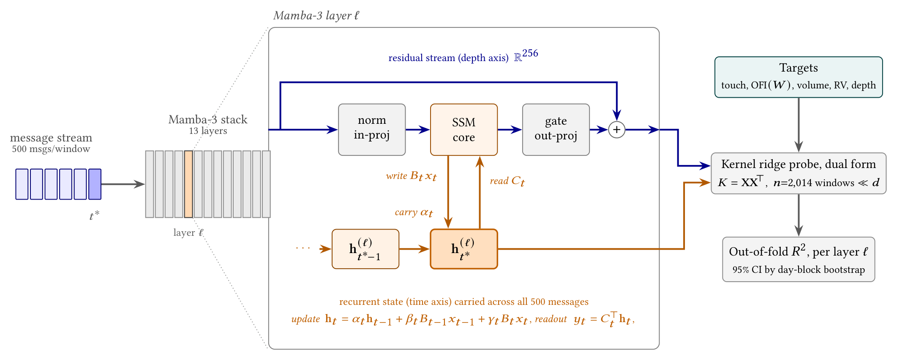
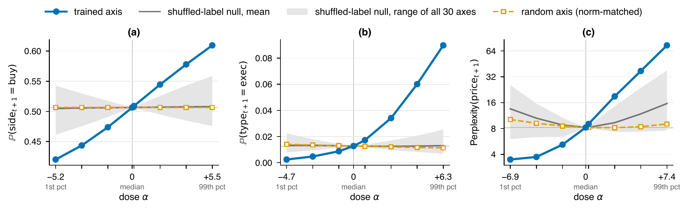

---

*This paper builds on the interpretability chapter of my [Master's thesis](/research_projects/msc-thesis/) in the [British Open-ended Learning and Discovery Lab (BOLD)](https://bold-lab.ai/) at the University of Oxford, supervised by [Professor Ani Calinescu](https://www.cs.ox.ac.uk/people/ani.calinescu/) and [Professor Jakob Foerster](https://www.jakobfoerster.com/). Valentin Mohl and I are joint first authors, and the paper will appear at the 7th ACM International Conference on AI in Finance (ICAIF ’26) in Milan, in November 2026, alongside our [adversarial post-training paper](/research_projects/icaif-adversarial-post-training/).*

  <a class="button" style="flex:1;text-align:center;margin:0;padding:5px 10px;background:rgba(0,0,0,0.1);" href="paper.pdf">Paper</a>

---

##### Overview

The message streams of the S&P 500 constituents alone comprise trillions of tokens of nanosecond-resolution order flow, comparable in size to the text corpora used to train frontier language models. This abundance now powers autoregressive foundation models trained directly on tokenised limit order book (LOB) messages, which generate realistic order flow and outperform GANs and parametric simulators on distributional benchmarks. Yet these models are black boxes. Backtested performance says nothing about behaviour when the market shifts, and thus cannot earn trust in tail events, where mistakes are costliest.

What such a model learns is a question with a well-known template: sequence models trained only on Othello moves develop an internal representation of the board, and similar world representations emerge in chess and program execution. We thus investigate whether a model trained only on the message stream builds an internal representation of the market, whose order book it is never shown, using an 8.2M-parameter Mamba-3 state-space model (SSM) trained on four years of data from eight large-cap US equities.

We find that the market representation lives in the recurrent state rather than in the residual stream, where interpretability work on Transformers usually looks. Realised order-flow imbalance (OFI), a central driver of short-horizon price moves, decodes there at *R*² ≈ 0.59 against about zero for a random-weights twin, with traded volume and realised volatility alongside. The representation generalises across stocks, including ones never seen in training, and is causally steerable. Its forward information is limited, however: a readout of the frozen state predicts the next 25 messages' mid-price move at only *R*² ≈ 0.04, on par with a readout of the visible book.

<figure style="margin:10px auto;max-width:900px;text-align:center;">
  
  <figcaption style="font-size:0.82em;opacity:0.75;margin-top:6px;">Probing loci in a message-only Mamba-3 model. At each token, the state carries over the previous state scaled by <i>αt</i> and adds two writes: the current token's, weighted by <i>γt</i>, and the previous token's, weighted by <i>βt</i>. From each layer we extract the per-token residual stream and the recurrent state, which accumulates across all messages of the window. Both are read out by the same kernel ridge probe.</figcaption>
</figure>

---

##### Contributions

1. **The first mechanistic interpretability study of a limit-order-book foundation model.** Probing, message-level attribution and causal steering are applied to a model trained natively on LOB data, extending emergent world-model analysis to real market data, a noisy, partially observed, high-stakes domain.
2. **Not just a picture of the market, but its flow.** The recurrent state encodes order-flow imbalance, traded volume and realised volatility far above random-weights and book-snapshot baselines, and this representation generalises across stocks, including ones never seen in training.
3. **Causal steerability.** Steering the state shifts the model's beliefs monotonically in dose against matched-norm nulls.

---

##### Probing, attributing and steering a message-only model

Our study uses a Mamba-3 SSM with 8.2M parameters, a residual-stream width of 256 and 13 layers. Each layer maintains a fixed-size recurrent state, updated per token: a 64 × 128 matrix per head, or 65,536 values across its eight heads. The model is trained on LOBSTER-format message streams of GOOG, AAPL, NVDA, AMZN, META, TSLA, MSFT and AMD from 2022 to 2025, from which we remove the book, with windows of 500 messages of 26 tokens each. Probing is tested on GOOG over January 2026, a period held out during training, with 2,014 windows spanning 20 trading days, and generalisation experiments also test the other seven training stocks as well as JPM and ORCL, two out-of-distribution stocks.

We probe each market statistic in the per-layer residual stream and in the flattened per-layer recurrent state, at a fixed message boundary near the end of the window. The targets are the touch (half the spread, in ticks), OFI over the window, traded volume (the log total size of visible executions), realised volatility (the standard deviation of per-message mid-price changes) and book depth (the log total resting volume on the ten best levels). Probes are kernel ridge regressions solved in dual form, and held-out *R*² is computed under day-grouped cross-validation, with the layer and penalty chosen by inner cross-validation, then compared with forward-chaining cross-validation for robustness. On top of that, we use two controls: a random-weights twin with identical architecture, which separates learned representations from architectural memory, and book-snapshot baselines, which measure what is recoverable directly from the book. Since the model never receives the book, whatever its state encodes was built from messages alone, and decodability above a single-snapshot baseline shows that the state holds information a snapshot of the current book does not carry.

Because the Mamba-3 recurrence admits an exact attention form, the state at the boundary is a weighted sum of one write per token. Summing the writes of a message's 26 tokens therefore attributes the state message by message, a recurrent analogue of an attention map.

A probe can establish only that a quantity is present in the state, not that the model uses it. To test use, we write a belief into the state: for each feature, the mean recurrent state of its top-tercile windows minus that of its bottom-tercile ones, added in all 13 layers at doses spanning the 1st to the 99th percentile of where real windows sit along that direction. The primary readout teacher-forces the real future messages and records the belief each feature should move (the probability of a buy, the probability of an execution, or the perplexity of the price forecast) against an unperturbed pass over the identical window. A second readout lets the model generate future messages freely and replays them through the matching engine. Effects are judged, at every dose, against 30 shuffled-label axes at matched norm and a random direction at the same norm.

---

##### The recurrent state encodes the market's flow, not a snapshot

In Transformer-based foundation models, interpretability probes the residual stream. In our SSM, we find that locus nearly empty of market structure: it holds only a weak readout of the current touch, and OFI, traded volume and realised volatility all decode at *R*² ≤ 0.06 from it, against 0.50 to 0.61 from the recurrent state. The touch reaches *R*² = 0.83 in the state, compared with 0.43 for the random-weights twin, whose high floor reflects that recent messages partially echo the current quotes even through random features. A readout of the book from about 500 messages earlier reaches only 0.49, so the state tracks the current touch better than the book at the start of the window predicts it.

The model encodes flow, not a snapshot. OFI decodes about five times better than a readout of the full boundary book snapshot (0.59 against 0.12), and unlike for the touch, the random-weights twin scores about zero, so training is the only source of the signal. The result also survives forward-chaining cross-validation at every lookback.

| Target | Trained | Forward-chaining CV | Random twin | Book snapshot |
|---|---|---|---|---|
| OFI level 1, *W* = 500 | 0.59 | 0.53 | 0.01 | 0.12 |
| OFI level 1, *W* = 100 | 0.49 | 0.44 | 0.03 | 0.12 |
| OFI level 1, *W* = 10 | 0.29 | 0.26 | 0.07 | 0.02 |
| OFI top 5, *W* = 500 | 0.61 | 0.51 | 0.01 | 0.08 |

Held-out OFI <i>R</i>² on GOOG from the trained state (layer chosen by nested cross-validation), its random-weights twin and the best readout of the boundary book snapshot. <i>W</i> is the lookback window in messages.

Decoding is not limited to the touch and OFI: traded volume and realised volatility also decode far above both the twin and the book snapshot. Depth is the exception, as a stale snapshot from about 500 messages earlier predicts it better (0.64) than the state does (0.38). Resting liquidity is highly persistent, and a state built from 500 messages has seen only the part of the book those messages touched.

| Target (*W* = 500) | Trained | Forward-chaining CV | Random twin | Book snapshot |
|---|---|---|---|---|
| Traded volume | 0.50 | 0.44 | 0.03 | 0.11 |
| Realised volatility | 0.51 | 0.50 | 0.15 | 0.23 |
| Ten-level book depth | 0.38 | 0.30 | 0.09 | 0.64 |

Held-out <i>R</i>² (layer chosen by nested cross-validation). For depth, the book baseline is the stale window-start snapshot, since the boundary snapshot contains the target itself.

Decodability is far from uniform across the stack: OFI peaks at layer 3, falls to near zero through the middle of the stack and partially recovers at the penultimate layer. Quadratic, RBF-kernel and MLP probes follow the same pattern, so the mid-stack dip is not a non-linear re-encoding.

Attribution shows how this code is assembled. Across all layers, the single newest message accounts for 58% of the total write magnitude, so a state snapshot is mostly a description of the present. The decoded OFI signal behaves in the opposite way: the newest message contributes 7%, and half the signal needs the last 56 messages. At the probe layer, four of the eight heads have state half-lives of 28 to 66 messages while the other four forget within a message, whereas in the twin no head exceeds a 10-message half-life. The long-horizon integrators are therefore built by training rather than given by the architecture. Over training, OFI decoding also keeps improving after LOB-Bench reaches a plateau, which suggests that longer pre-training may reinforce it.

The representation is not specific to GOOG. The touch decodes on all ten stocks, including the out-of-distribution JPM and ORCL, whereas raw *R*² for level-1 OFI varies: the state reaches 0.26 to 0.60 on all but META and MSFT, where it is near zero, while the book snapshot stays at *R*² ≤ 0.14 and the twin at *R*² ≤ 0.04 on every stock. The variation largely tracks how much of each stock's OFI variance sits in rare bursts, measured by the share held by the top 1% of windows. Under winsorised or rank *R*², which limit the weight of these tails, OFI is represented across the board, with level-1 OFI at *R*² ≥ 0.4 on every stock.

---

##### Steering moves the model's beliefs, but the state carries little forward information

Following a difference-of-means approach, we push the state along each feature's axis, simulating high or low flow, heavy or light trading, and turbulent or calm prices. The model's beliefs respond cleanly and monotonically for all three features. Across the seen range, the probability of a buy moves from 0.42 to 0.61 and the probability of an execution from 0.002 to 0.090, while a turbulence push widens the next-price forecast nine-fold and a calm push sharpens it. At every dose, the trained response lies outside the full range of the 30 shuffled-label axes. For volatility, the null itself widens the forecast at large doses, possibly because a push of that size moves the state into a region the model has not seen, but a turbulent push along the trained axis widens it far more than any null or random axis. Overall, the responses follow the specific encoded directions, not the size of the push.

<figure style="margin:10px auto;max-width:900px;text-align:center;">
  
  <figcaption style="font-size:0.82em;opacity:0.75;margin-top:6px;">Model beliefs about the next message after pushing each feature's state axis by a dose <i>α</i>: (a) order flow, (b) traded volume and (c) realised volatility. Grey: mean and range of 30 norm-matched axes built from shuffled labels. Orange: a norm-matched random axis. Perplexity measures the effective width of the next-price forecast in one-tick levels.</figcaption>
</figure>

Steered beliefs only partially materialise when the model generates messages from the steered state and they are replayed through the matching engine. The volume push carries through to the market: over 50 generated messages, median executed volume rises from 25 shares unsteered to 187 under a positive push and falls to 1 under a negative one. The flow push carries through to the order flow on the sell side, but not to the price, and the volatility push does not carry through, as realised volatility stays within the null band. Causal control over the generated market thus ranks traded volume above order flow above volatility, consistent with how directly single messages determine each statistic, which means there is a difference between how decodable and how controllable a feature is.

We next ask whether the frozen state carries information about the market's near future, without any autoregressive rollout. It carries only a weak signal: it explains 4% of the variance of the next-25-message mid-price move, level with a probe of the book snapshot (*R*² = 0.036), and at most 5% of future top-5 OFI, for which the book snapshot carries almost no signal. Directional accuracy tells a similar story: on windows where the mid-price moved, the state calls the direction right 61.2% of the time at 25 messages, level with the book-snapshot readout (61.8%), and its skill reaches chance by 500 messages. The representation thus tracks the current flow but carries little forward information.

---

##### Key results

+ The market representation of a message-only LOB foundation model lives in its recurrent state: OFI, traded volume and realised volatility decode at *R*² of 0.50 to 0.61 there, against at most 0.06 from the residual stream.
+ The state encodes flow rather than a snapshot: OFI decodes at 0.59 against 0.12 from the full book snapshot and about zero from a random-weights twin, integrated by learned long-memory heads, and remains decodable on stocks never seen in training.
+ Steering the state shifts next-message beliefs monotonically in dose, outside the range of all 30 shuffled-label axes at every dose, and causal control over the generated market ranks traded volume above order flow above volatility.
+ Forward information is limited: the frozen state explains 4% of the next-25-message mid-price variance, level with a readout of the visible book.

Trained only to predict the next token of the message stream, the model has learned not only a picture of the market, but its flow. Beyond interpretability, the approach also has practical potential: linear maps read the market dynamics from the state at the cost of a single matrix product, far cheaper than estimating them from autoregressive rollouts, which could help make foundation models more practical for latency-sensitive applications such as high-frequency trading. A steerable state also offers a handle for scenario generation without conditioning inputs or retraining. Overall, this work takes a first step towards using LOB foundation models not only as market simulators, but as representation engines whose internal state can be read and steered.
