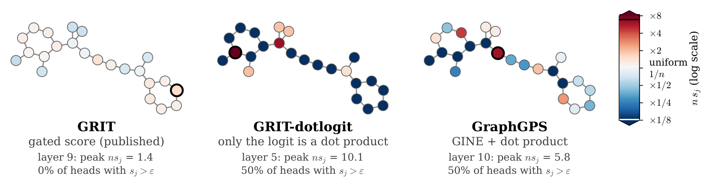

---

*This workshop paper is derived from my class project in the [Geometric Deep Learning](https://www.cs.ox.ac.uk/teaching/courses/2025-2026/geodl/index.html) class at the University of Oxford, taught by [Professor Michael Bronstein](https://www.cs.ox.ac.uk/people/michael.bronstein/).*

  <a class="button" style="flex:1;text-align:center;margin:0;padding:5px 10px;background:rgba(0,0,0,0.1);" href="paper.pdf">Paper</a>
  <a class="button" style="flex:1;text-align:center;margin:0;padding:5px 10px;background:rgba(0,0,0,0.1);" href="https://github.com/alexandre-bismuth/graph-transformer-sinks">Code</a>

*The details of the course project (essentially an early version of this workshop paper) can be found on [this page](/course_projects/gdl-attention-sinks/).*

---

##### Overview

A striking empirical property of Large Language Models is the attention sink: a token that receives a large share of all attention. In Llama 3.1 405B, nearly 80% of attention heads sink on the semantically meaningless `<BOS>` token. Far from wasting compute, sinks are thought to slow the mixing of information between tokens and so protect deep models against over-mixing.

Graph Transformers face a related pressure: depth causes over-smoothing, and global attention makes it worse, since softmax over ever more nodes must disperse toward uniform mixing. A designated sink node might be a natural defence, yet nothing in an ordinary graph plays the role of `<BOS>`: a graph has no first token, and permutation equivariance forbids preferring one of two nodes the model cannot tell apart. What is missing is an account of where a sink can form on a graph at all, and of which architectural ingredient decides whether one does.

This paper asks whether Graph Transformers form attention sinks and, if not, what prevents them. I study GRIT, a state-of-the-art Graph Transformer without message passing, so attention alone mixes information between nodes. The graph itself is not the barrier: I prove three bounds on received attention, from symmetry, locality, and the spread of attention scores, and find both graph-side bounds loose on real molecules. The attention scoring function is the main cause, as the logit swap below and accuracy-matched controls show.

<figure style="margin:10px auto;max-width:760px;text-align:center;">
  
  <figcaption style="font-size:0.82em;opacity:0.75;margin-top:6px;">Changing only the scoring function creates a sink. Each atom of a 23-atom ZINC test molecule is shaded by the attention it receives, averaged over queries and heads at each model's peak-sinking layer: blue below the uniform share 1/23, red above. Swapping only GRIT's gated logit for a dot product (middle) moves attention off the other atoms and onto one, as in GraphGPS (right).</figcaption>
</figure>

---

##### Contributions

1. **GRIT rarely forms attention sinks on molecules.** On ZINC, fewer than one head in ten sinks on the same node, against 0.415 for GraphGPS and 0.95 to 1.00 for small language models at the same context length, and its sink rate falls as graphs grow, the opposite of the trend in LLMs.
2. **Three bounds on received attention, computable head by head.** Symmetry, locality, and the spread of attention scores each cap the attention any node can receive. The symmetry bound is tight on symmetric graphs, whatever the architecture, but on real molecules neither graph-side bound rules out a sink.
3. **The attention scoring function is the main cause.** Replacing only GRIT's gated logit with a dot product raises its sink rate from 0.090 to 0.680 on identical graphs, and accuracy-matched controls show that this is not a training artefact. In dot-product models the sink is close to a no-op, as in LLMs, whereas GRIT's most-attended nodes matter to its predictions.

---

##### GRIT rarely forms attention sinks on molecules

Graph structure enters GRIT through Relative Random Walk Probabilities (RRWP), which initialise a learned pair representation. GRIT scores a pair by gating the sum of query and key with that representation, passing it through a signed square root, and clipping it to [0, 5] before a scalar readout; dot-product attention instead takes the inner product of query and key, which can grow with the product of the two node norms. I compare against GraphGPS with RWSE, a hybrid of message passing and dot-product attention, and train on ZINC-12k, a regression task on graphs of roughly 23 nodes, and on Peptides-func, a classification task on larger graphs, split by node count into four quartiles of equal training size. Results are means with a 95% confidence interval on the full test set over three to five seeds.

My central measurement is the sink score of a node, the attention it receives averaged over all queries. A node is a sink in a head when its sink score exceeds ε = 0.3, about seven times the uniform share on a 23-node graph, and the sink rate is the largest fraction of heads that share one sink node, averaged over test graphs, at the peak-sinking layer.

On ZINC, GRIT's sink rate is 0.090 ± 0.028: fewer than one head in ten sinks on the same node, against 0.415 ± 0.194 for GraphGPS and 0.95 to 1.00 for small language models at the same context length, and GRIT stays below GraphGPS at every threshold from 0.1 to 0.8. The trend with size also runs backwards. Language models trained on longer contexts form stronger sinks, whereas GRIT's sink rate falls from 0.238 on the smallest Peptides-func quartile to 0.045 on the largest. GRIT's largest squared node norm still grows across layers from 2.4 to 4.8 times the mean, as sink tokens' norms do in language models, so something in GRIT keeps large norms from attracting attention.

---

##### What can prevent a sink?

Three things can prevent a node from accumulating attention from many others at once: symmetry, since an equivariant model must treat nodes the labelled graph does not distinguish alike; locality, since nodes that attend mostly to their neighbourhood leave little attention for distant ones; and scoring range, since softmax concentrates only when logits spread far apart. Assuming permutation equivariance over the graph, its node features and positional encodings, I prove that the sink score of every node is bounded by the smallest of three quantities: one over the size of its orbit under the automorphisms of the input; the largest attention any query sends beyond radius *r*, plus the remainder times the fraction of nodes within that radius; and eΔ / (eΔ + *n* − 1), with Δ the largest logit spread of any query.

The orbit term is the standard fact that equivariant maps are constant on orbits. What I add is that every bound can be computed head by head, so I can test whether any is tight enough to prevent a sink. The symmetry bound is tight on symmetric graphs: every checkpoint with an equivariant positional encoding, even the dot-product models that sink heavily on molecules, spreads attention evenly across cycles of identical atoms and bonds (C8 to C24). Conversely, Laplacian encodings, whose eigenvector signs and bases are arbitrary, break equivariance, and a dot-product Transformer then puts almost all attention (0.999) on one node.

On real molecules, neither graph-side bound is tight: atoms rarely have symmetric counterparts, and attention is nonlocal (median λ1 ≥ 0.91). The third bound does differ between architectures, since GRIT clips its scores elementwise, so their spread never exceeds 5‖*a*‖1, whereas dot-product scores can grow without limit with the attended node's norm. Yet this cap does not explain why GRIT rarely sinks: in the trained models it ranges from 2.7 to 11.7 across layers, above the spread of 2.2 a sink needs at ZINC size, and removing the clip leaves GRIT's sink rate low. The graph thus leaves GRIT and GraphGPS equally free to sink on the same molecules, yet their sink rates differ more than four-fold: the models themselves must decide.

---

##### The attention scoring function drives the gap

On identical ZINC graphs, GraphGPS and GRIT differ in heads, positional encoding, dropout, and message passing as well as in scoring, so I change one component at a time. Replacing only GRIT's logit with a dot product (GRIT-dotlogit), leaving RRWP, the pair representation and the values unchanged, raises its sink rate from 0.090 ± 0.028 to 0.680 ± 0.098, above GraphGPS's. Removing message passing from GraphGPS does not lower its sink rate either (0.507 ± 0.159). Message passing is therefore not what suppresses sinks; the scoring function is.

| Arm | Sink rate | Test MAE | Ablation ratio |
|---|---|---|---|
| GRIT (gated scoring, RRWP) | 0.090 ± 0.028 | 0.064 ± 0.009 | 2.06 ± 0.79 |
| GRIT-dotlogit (dot-product logit only) | 0.680 ± 0.098 | 0.373 ± 0.224 | 1.22 ± 0.43 |
| GRIT-blind (gated scoring, no structure) | 0.214 ± 0.143 | 0.542 ± 0.018 | 1.17 ± 0.07 |
| GRIT-dot (dot-product scoring, no structure) | 0.532 ± 0.061 | 0.543 ± 0.006 | 1.15 ± 0.12 |
| GRIT-dotbias (GRIT-dot + pair bias) | 0.521 ± 0.059 | 0.268 ± 0.068 | 1.19 ± 0.19 |
| GraphGPS (GINE + dot attention) | 0.415 ± 0.194 | 0.072 ± 0.005 | 1.01 ± 0.02 |
| GraphGPS-none (MPNN removed) | 0.507 ± 0.159 | 0.200 ± 0.017 | 1.11 ± 0.09 |
| GraphGPS + virtual node | 0.559 ± 0.177 | 0.066 ± 0.015 | 1.00 ± 0.02 |
| GRIT + virtual node | 0.095 ± 0.019 | 0.065 ± 0.008 | 1.93 ± 1.19 |

Changing each component individually on ZINC (mean ± 95% CI). Ablation ratio: test MAE after removing all attention onto the most-attended node, divided by that for a random node.

The swap also slows training (test MAE 0.064 to 0.373), but controls at matched accuracy show that this is not why it sinks. Without any graph structure, GRIT's score and a dot product reach the same accuracy (GRIT-blind and GRIT-dot) yet sink at rates of 0.214 and 0.532, and GraphGPS with a virtual node matches GRIT's accuracy yet sinks six times as often. Sink formation tracks mainly the form of the score; accuracy tracks access to graph structure. Even a loss that rewards concentrated attention lifts GRIT's sink rate only to 0.131.

**Why large norms do not attract attention in GRIT.** A dot-product logit grows linearly with the attended node's hidden state, so a node with a large enough norm can claim almost all of a query's attention. GRIT's score instead saturates: in layers 2 to 10, at least 96% of its coordinates sit at 0 or 5, so the logit is a sum of readout weights selected by which coordinates fire, not by input magnitude. Scaling up one node's hidden state confirms this: doubling it makes it a sink in up to 38.8% of heads in GRIT-dotlogit but at most 0.2% in GRIT. GRIT thus grows high-norm nodes without attending to them.

| Scale | GRIT | GRIT-noclamp | GRIT-official | GRIT-dotlogit | GRIT-dot | GraphGPS |
|---|---|---|---|---|---|---|
| ρ = 2 | 0.2 | 1.4 | 0.4 | 38.8 | 34.1 | 11.5 |
| ρ = 8 | 0.3 | 16.2 | 5.8 | 62.0 | 48.1 | 26.2 |
| ρ = 32 | 1.3 | 54.0 | 19.4 | 66.9 | 51.9 | 32.1 |

Percentage of heads in which one node, whose input is scaled by ρ, becomes a sink (maximum over layers).

**Giving the model a token to sink on.** A virtual node is the graph counterpart of `<BOS>`: chemically empty, connected to every node, and exempt from the symmetry bound, since no automorphism can move it. On the symmetric cycles above, GraphGPS sends all of its attention to the virtual node, GRIT only about half to two-thirds, and inconsistently across seeds. On molecules, a virtual node leaves GRIT's sink rate low (0.095 ± 0.019), even with a logit penalty toward it. Symmetry says where a sink may appear; the scoring function decides whether one does.

The ablation column of the first table shows what these sinks are worth: removing all attention to the most-attended node leaves the dot-product models' test MAE close to that for a random node (1.00 to 1.22 times), but GRIT's twice as high (2.06). In dot-product models the sink is thus close to a no-op, as in LLMs, whereas GRIT's most-attended nodes matter to its predictions.

---

##### Key results

+ GRIT rarely forms attention sinks on molecules: a sink rate of 0.090 on ZINC against 0.415 for GraphGPS, and it sinks less when trained on larger graphs, the opposite of the trend in LLMs.
+ The graph is not the reason: symmetry forbids sinks only on inputs far more regular than a molecule, and the attention measured on molecules is too nonlocal for locality to matter.
+ The attention scoring function is the main cause: replacing only GRIT's gated logit with a dot product raises its sink rate from 0.090 to 0.680 on identical graphs, and accuracy-matched controls show the gap is not a training artefact.
+ GRIT's clipped score saturates, so its logit barely responds to a node's norm: a doubled hidden state makes a sink in at most 0.2% of GRIT's heads against 38.8% with a dot-product logit.

The LLM sink therefore looks like a property of dot-product attention rather than of Transformers. Read as attentional networks over a complete graph, Transformers differ from GRIT in two ways, a first token and a dot-product score, and these experiments separate the two: on molecules, dot-product scoring sinks with or without a designated token, while GRIT's gated scoring rarely sinks in either case. Whether sinks protect Graph Transformers against over-mixing remains open, since the 10-layer models show little over-smoothing to prevent. The study covers one gated-score architecture on molecular graphs alone; further architectures and non-molecular graphs come next.
